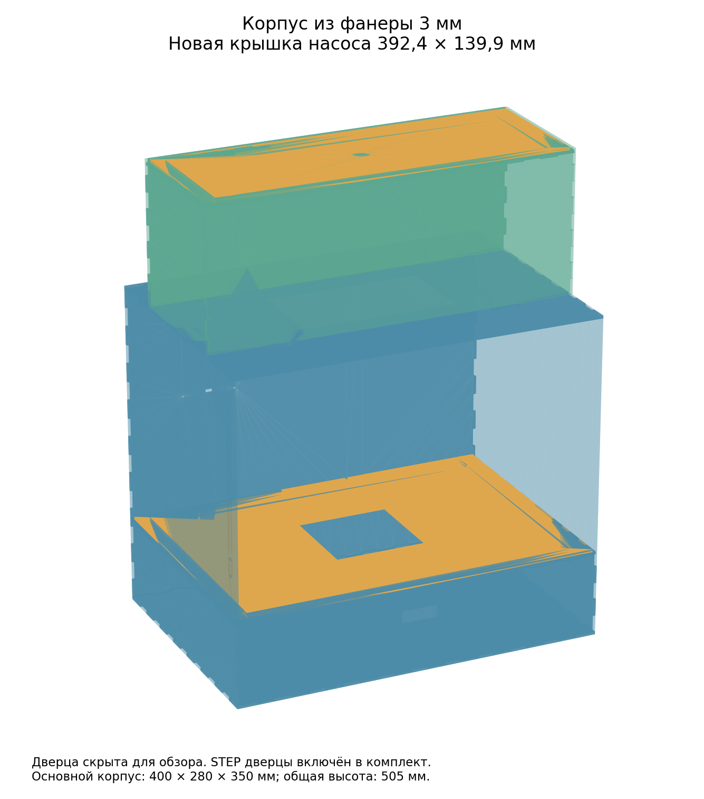
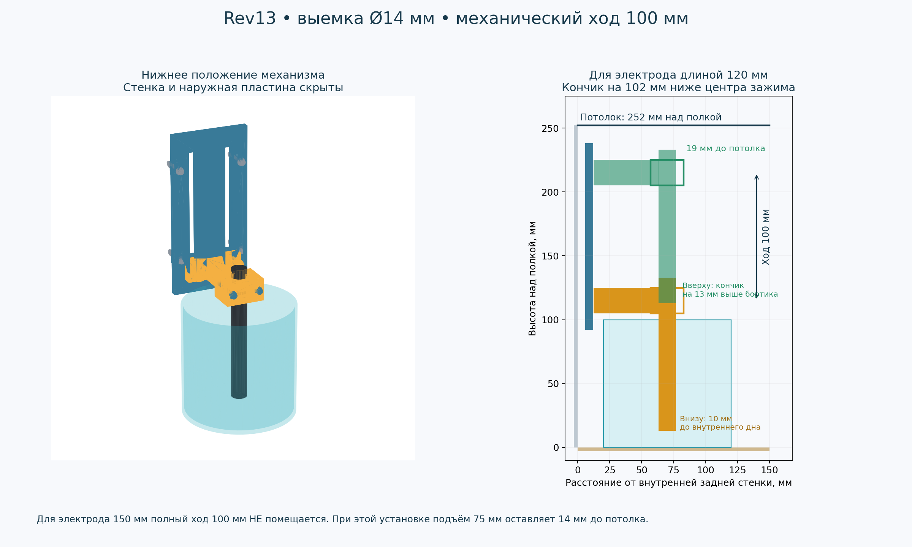

# Титратор: корпус, держатель электрода и петли

Готовые файлы для лазерной резки фанеры 3 мм и 3D-печати PETG.
## Навигация

| Раздел | Содержимое |
|---|---|
| [01_body](01_body) | 21 пластина корпуса: DXF, STEP, модель корпуса и эскиз |
| [02_electrode](02_electrode) | Держатель Rev13: Ø14 мм, механический ход 100 мм; STL, STEP, раскладка, проверочные модели |
| [03_hinges](03_hinges) | Петли Rev12 под осевой винт М3×30: STL и STEP |
| [04_full_assembly](04_full_assembly) | Полная конструкция с уменьшенной крышкой и новым держателем, нижнее/верхнее положения |

## Актуальные изменения

- Все фанерные пластины толщиной 3 мм; печатные детали объёмные, переменной толщины.
- Передняя дверца Front_Door.new: 392,4×250,2 мм, отверстия петель сохранены.
- Крышка Pump_Cover_Lid.new: 392,4×139,9 мм; захват Ø20 мм. От исходного размера длина уменьшена на 1 мм, ширина — на 3,5 мм.
- Держатель имеет выемку Ø14 мм для стержня Ø13,7 мм; поднимается вручную и фиксируется двумя М3×20.
- Полный механический ход 100 мм проверен для электрода длиной 120 мм.
- Электрод 150 мм при полном ходе упирается в потолок. При кончике на 102 мм ниже центра
  зажима подъём 75 мм оставляет 14 мм до потолка, без учёта разъёма/кабеля. Встроенного упора на 75 мм нет.
- Новая крышка перекрывает опоры на 16,2 мм по торцам и 14,95 мм вдоль длинных сторон в ровном корпусе; на изготовленном корпусе проверить посадку.

## Что изготавливать

DXF из 01_body/dxf — лазер. STL из 02_electrode/stl и 03_hinges/stl — 3D-печать.
Суффиксы x1/x2 задают количество экземпляров. Каждый индивидуальный STL содержит одну деталь.
Альтернативная раскладка всех 7 деталей держателя из print_plate — дубликат набора, не дополнительный комплект.
STEP нужен для просмотра и сборки, это не дополнительные детали.

Общие STEP записаны одним продуктом с несколькими телами. Открывать как многотельную деталь,
не включать разбиение тел на отдельные документы. Нативные SLDASM/SLDPRT и параметрическое дерево не приложены.

## Эскизы

## Проверки

Держатель проверен в 21 положении хода, зажим и фиксация высоты — геометрически.
Уменьшенная крышка установлена в общие модели по центру и проверена на пересечения.
Физическая прочность, посадки после печати, деформация фанеры и настоящий электрод требуют примерки.
Конструкция не испытана как готовое изделие. В самом SolidWorks файлы не проверялись.
